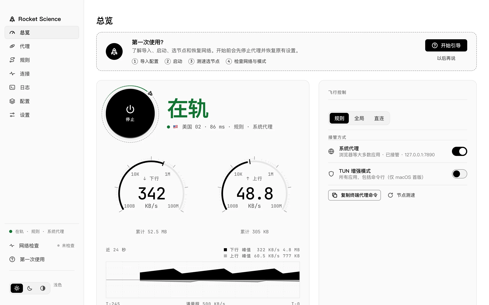
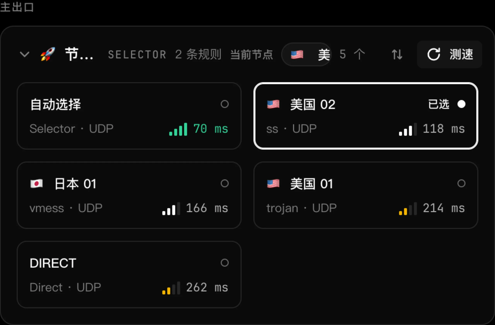
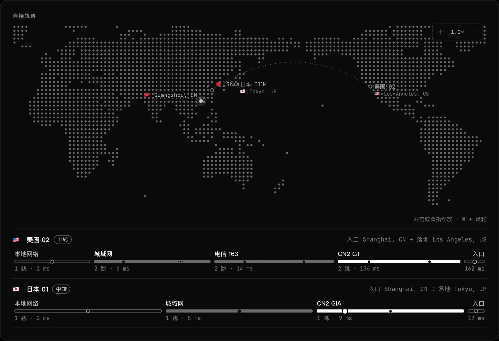
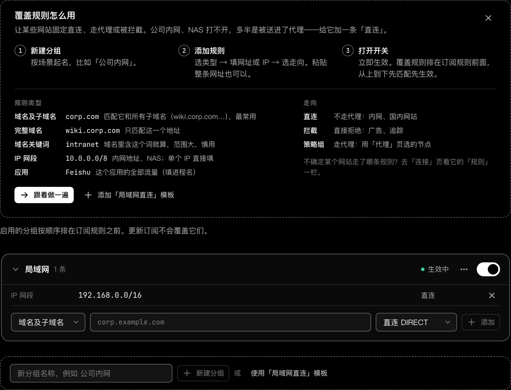
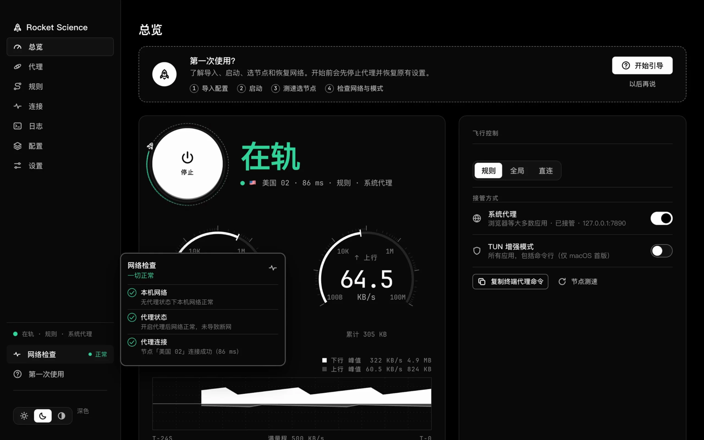

<div align="center">
  
  <h1>Rocket Science</h1>
  <p>A desktop proxy client for the mihomo core on macOS, Windows, and Linux</p>
  <p>
    <a href="https://github.com/Slone123c/rocketscience/releases/latest">Download</a> ·
    <a href="https://slone123c.github.io/rocketscience/en/">Website</a> ·
    <a href="README.md">中文</a> ·
    <a href="LICENSE">License</a>
  </p>
  <p>
    <a href="https://github.com/Slone123c/rocketscience/releases/latest"></a>
    <a href="LICENSE"></a>
    
  </p>
</div>

<picture>
  <source media="(prefers-color-scheme: dark)" srcset="site/assets/screens/overview-dark.webp">
  
</picture>

## Features

- **Overview & instant control**: Live core status, active exit node, throughput gauges, and a 24-second traffic curve, with mode and takeover toggles in place. Restores previous proxy settings on stop or quit.
- **Latency testing & route trajectory**: Displays main and branch policy chains with batch latency testing and sorting, plus an interactive map below the overview showing entry, landing node, and hop-by-hop routes.
- **Step-by-step network check**: Verifies direct internet, proxy takeover, and node reachability in sequence, and asks before switching to a working node.
- **Profiles & rule overrides**: Import subscription URLs or local YAML files, schedule updates, and edit configurations in-app. Enabled override groups stay ahead of subscription rules across updates.
- **Menu-bar & tray panel**: Monitor speeds, switch modes or nodes, toggle system proxy or Trusted Wi-Fi, and copy terminal proxy commands without opening the main window.

<table>
  <tr>
    <td></td>
    <td></td>
  </tr>
  <tr>
    <td></td>
    <td><a href="https://slone123c.github.io/rocketscience/en/#interactions"></a></td>
  </tr>
</table>

## Download & Install

Get the latest build from [Releases](https://github.com/Slone123c/rocketscience/releases/latest):

| Platform | Arch | Package | First-launch notes |
| --- | --- | --- | --- |
| macOS 13+ | Apple Silicon / Intel | DMG | Unsigned build: right-click → Open, or run `xattr -dr com.apple.quarantine "/Applications/Rocket Science.app"` |
| Windows 10/11 | x86_64 / ARM64 | Installer / Portable ZIP | Requires WebView2 Runtime; on SmartScreen choose More info → Run anyway |
| Linux | x86_64 / ARM64 | `.deb` / `.tar.gz` | Recommended: `sudo apt install ./rocketscience_<version>_<arch>.deb` (resolves GTK3, WebKitGTK 4.1, and `libayatana-appindicator3-1`); GNOME tray icon requires the AppIndicator extension (enabled by default on Ubuntu) |

## Platform Support

| Platform | System Proxy | TUN Mode | Menu Bar / Tray | Package Formats |
| --- | --- | --- | --- | --- |
| macOS 13+ | Supported (auto set & restore) | Supported (one-time admin authorization) | Menu-bar popover | DMG |
| Windows 10/11 | Supported (auto set & restore) | Not available yet (macOS only) | System tray panel | Installer / Portable ZIP |
| Linux | Supported (GNOME / KDE) | Not available yet (macOS only) | System tray panel | `.deb` / `.tar.gz` |

## Building from Source

```sh
bun install
bun run build:web
bun run build:release --platform=darwin/arm64
```

See [docs/BUILDING.md](docs/BUILDING.md) for full prerequisites, test commands, and platform output folders.

## Acknowledgements

- [mihomo](https://github.com/MetaCubeX/mihomo) — proxy core
- [MyGo](https://github.com/egoist/mygo) — desktop framework
- Additional third-party licenses in [THIRD_PARTY_NOTICES.md](THIRD_PARTY_NOTICES.md)

## License

[GPL-3.0](LICENSE)
