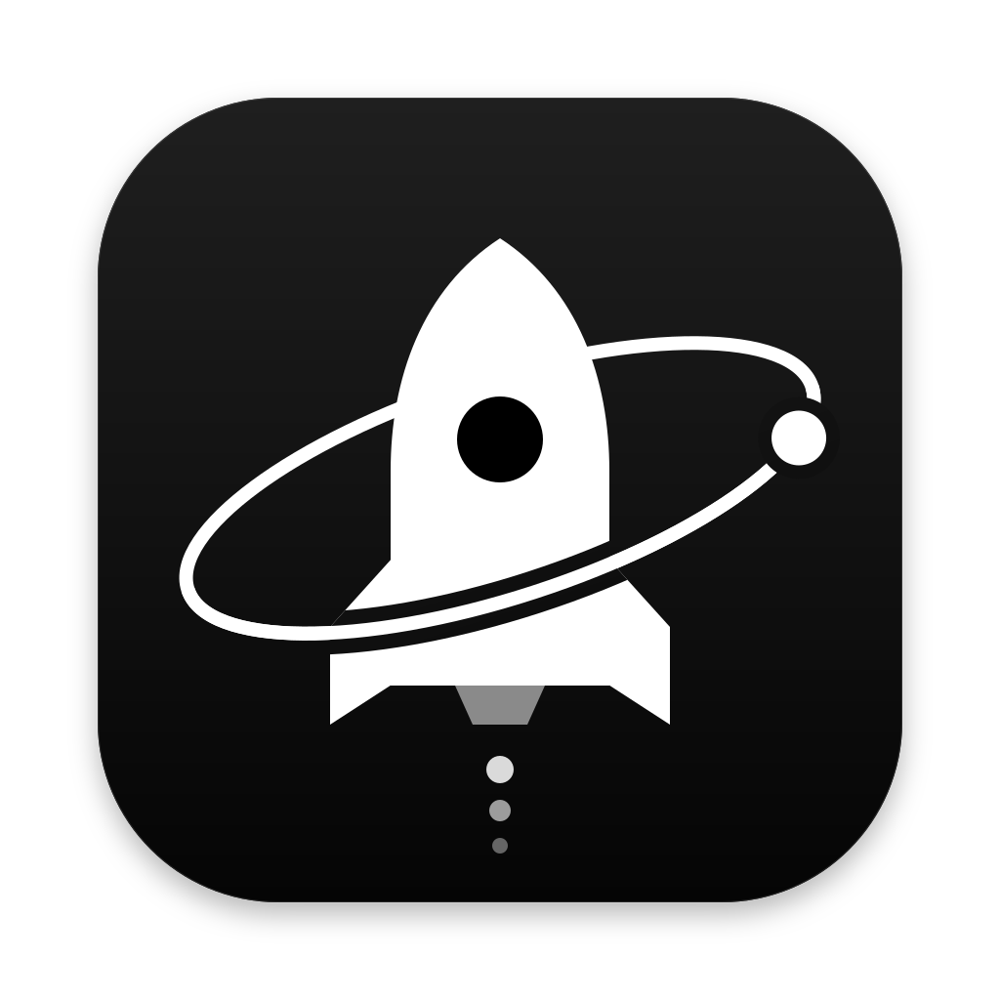
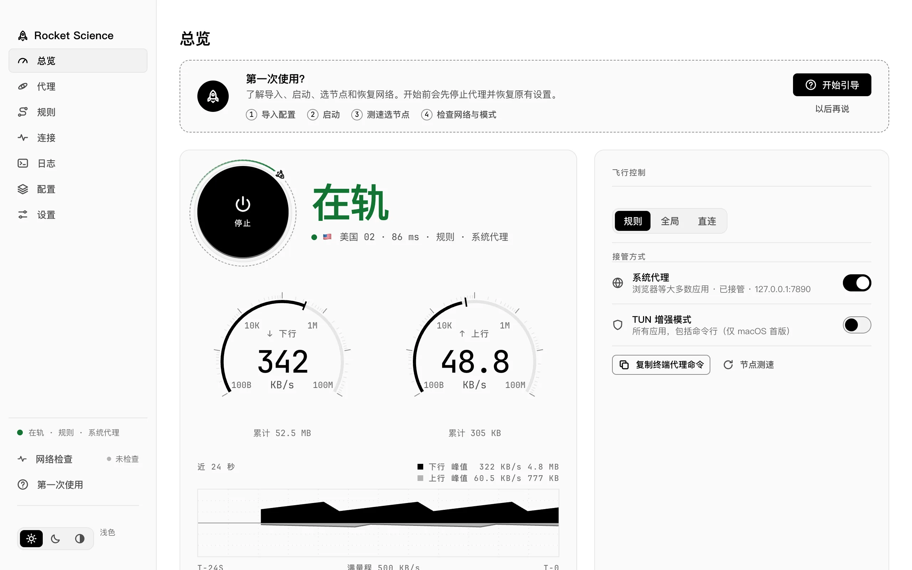
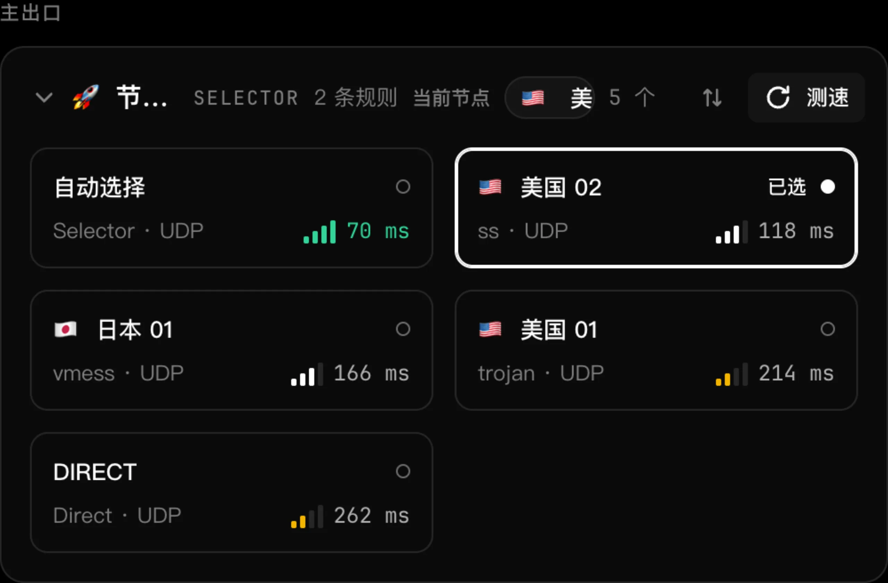
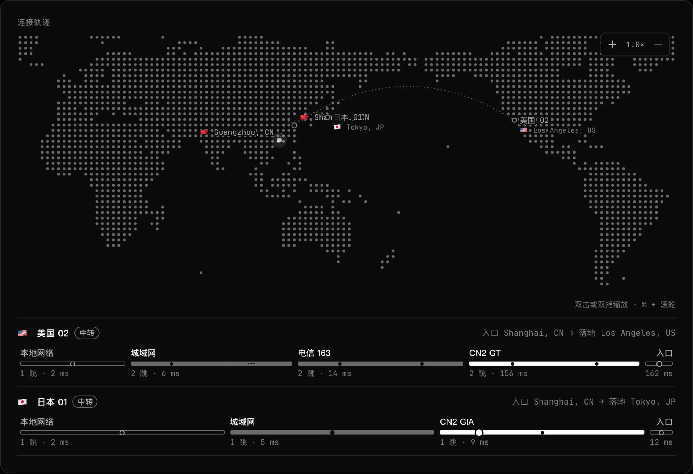
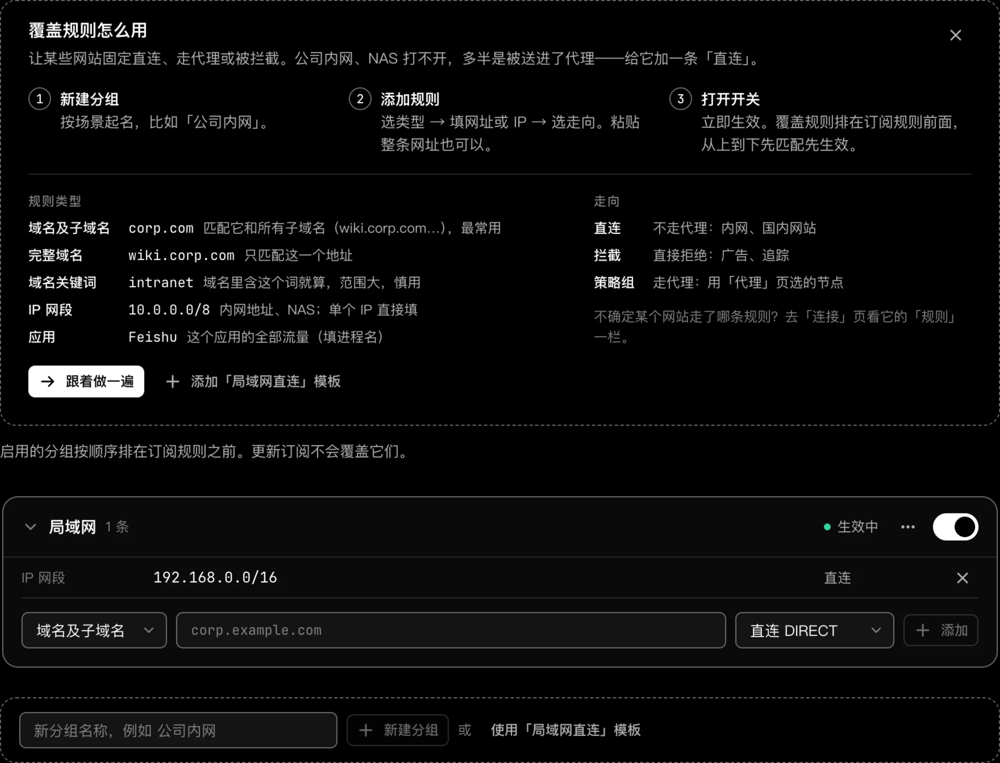
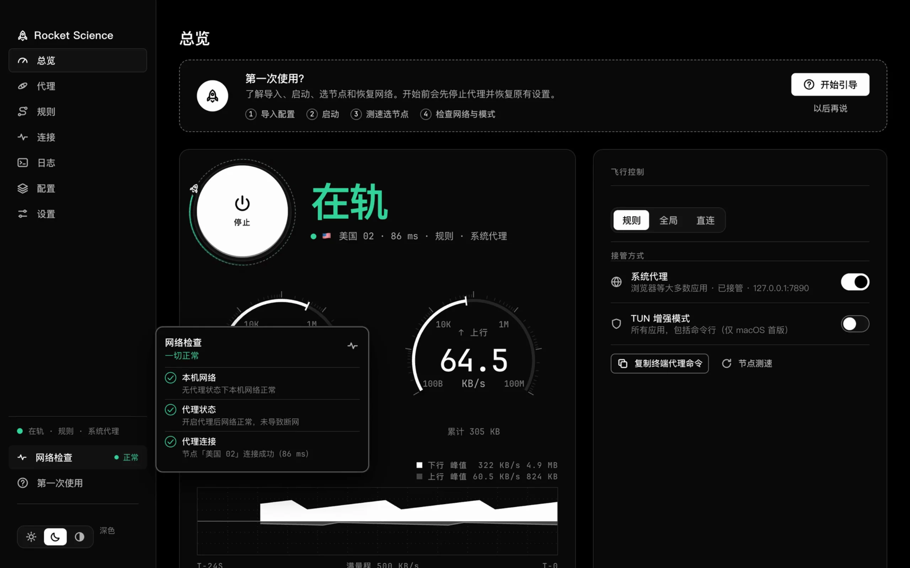

<div align="center">
  
  <h1>Rocket Science</h1>
  <p>面向 macOS、Windows 与 Linux 的 mihomo 桌面代理客户端</p>
  <p>
    <a href="https://github.com/Slone123c/rocketscience/releases/latest">下载</a> ·
    <a href="https://slone123c.github.io/rocketscience/">官网</a> ·
    <a href="README.en.md">English</a> ·
    <a href="LICENSE">许可证</a>
  </p>
  <p>
    <a href="https://github.com/Slone123c/rocketscience/releases/latest"></a>
    <a href="LICENSE"></a>
    
  </p>
</div>

<picture>
  <source media="(prefers-color-scheme: dark)" srcset="site/assets/screens/overview-dark.webp">
  
</picture>

## 功能

- **总览与即时控制**：实时展示内核运行状态、出口节点、上下行速率与 24 秒流量曲线，并在同页切换规则、全局、直连模式及接管方式，停止或退出时自动恢复原有网络设置。
- **节点测速与路由轨迹**：按主出口与分流组展示策略链路，支持批量延迟测速与排序；总览底部内置连接轨迹地图，直观显示入口地、落地节点与逐跳链路。
- **分步网络检查**：依次检查本机直连、代理接管与节点连通性；定位到可用节点后先向你确认再切换。
- **订阅与规则覆盖**：支持订阅链接、本地 YAML 导入、定时更新与内置编辑器；启用的覆盖分组按顺序排在订阅规则之前，更新订阅不覆盖自定义规则。
- **菜单栏与托盘速控**：直接查看实时速率、切换模式或节点、开关系统代理与可信 Wi-Fi 直连，并一键复制终端代理命令。

<table>
  <tr>
    <td></td>
    <td></td>
  </tr>
  <tr>
    <td></td>
    <td><a href="https://slone123c.github.io/rocketscience/#interactions"></a></td>
  </tr>
</table>

## 下载与安装

前往 [Releases](https://github.com/Slone123c/rocketscience/releases/latest) 下载对应平台包：

| 平台 | 架构 | 安装包 | 首次启动说明 |
| --- | --- | --- | --- |
| macOS 13+ | Apple Silicon / Intel | DMG | 未签名/公证：右键应用选择「打开」，或执行 `xattr -dr com.apple.quarantine "/Applications/Rocket Science.app"` |
| Windows 10/11 | x86_64 / ARM64 | 安装程序 / 便携 ZIP | 需 WebView2 运行时；SmartScreen 提示时点击「更多信息」→「仍要运行」 |
| Linux | x86_64 / ARM64 | `.deb` / `.tar.gz` | 推荐 `sudo apt install ./rocketscience_<version>_<arch>.deb`（自动安装 GTK3、WebKitGTK 4.1 与 `libayatana-appindicator3-1`）；GNOME 托盘图标需 AppIndicator 扩展（Ubuntu 默认已启用） |

## 平台支持

| 平台 | 系统代理 | TUN 增强模式 | 菜单栏 / 托盘 | 安装包格式 |
| --- | --- | --- | --- | --- |
| macOS 13+ | 支持（自动写入与恢复） | 支持（首次需一次管理员授权） | 菜单栏速控面板 | DMG |
| Windows 10/11 | 支持（自动写入与恢复） | 暂未提供（仅 macOS） | 系统托盘面板 | 安装程序 / 便携 ZIP |
| Linux | 支持（GNOME / KDE） | 暂未提供（仅 macOS） | 系统托盘面板 | `.deb` / `.tar.gz` |

## 从源码构建

```sh
bun install
bun run build:web
bun run build:release --platform=darwin/arm64
```

详细依赖、测试命令与跨平台构建说明见 [docs/BUILDING.md](docs/BUILDING.md)。

## 致谢

- [mihomo](https://github.com/MetaCubeX/mihomo) — 代理内核
- [MyGo](https://github.com/egoist/mygo) — 桌面应用框架
- 其余第三方组件许可见 [THIRD_PARTY_NOTICES.md](THIRD_PARTY_NOTICES.md)

## 许可证

[GPL-3.0](LICENSE)
